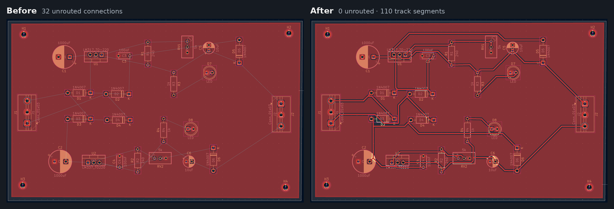
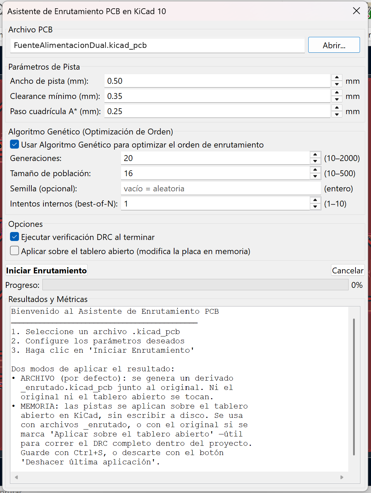
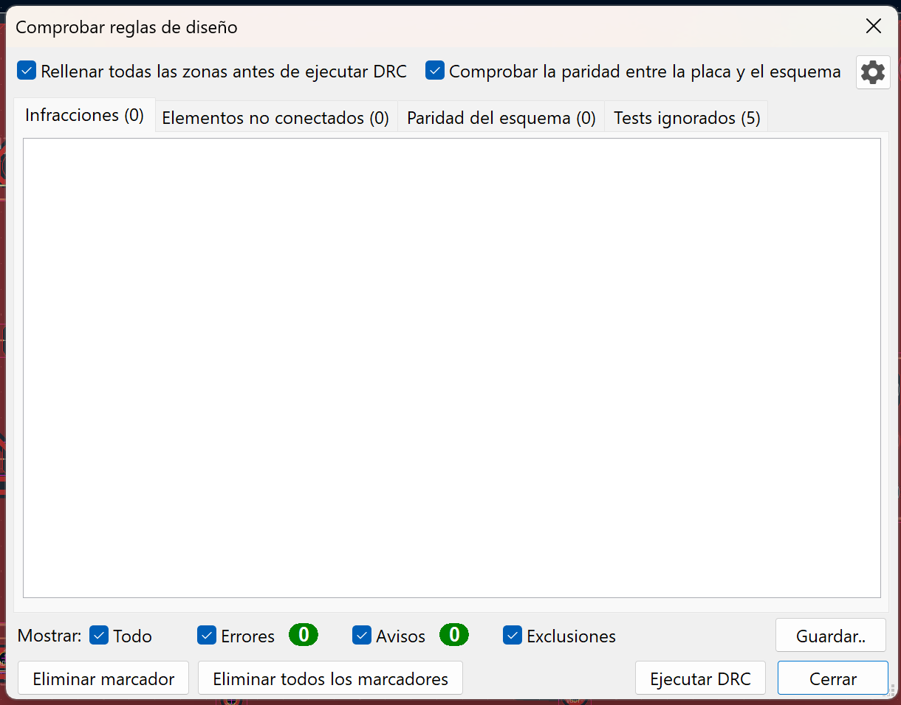
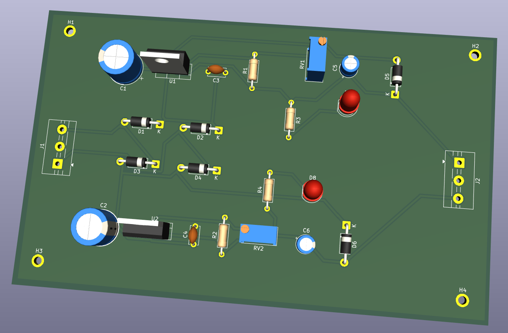

🇪🇸 [Leer en español](README.es.md)

# KiCad Single-Layer Autorouter

**Single-layer autorouter for KiCad 10: A\* pathfinding with a genetic algorithm for net ordering. Pure Python, no external dependencies.**

It runs as a KiCad 10 Action Plugin or from the command line.



---

## What it does

It routes the tracks of a single-layer (F.Cu) PCB using two algorithms:

1. **Genetic Algorithm (GA)**: optimizes the *order* in which connections are routed, to minimize total length and reduce track crossings.
2. **A\***: finds the shortest obstacle-free path for each individual connection on a configurable grid (0.25 mm by default).

Nets covered by a copper zone (typically GND) are treated as connected through the pour and are not routed with individual tracks.

---

## Limitations

Please read this before trying it on your board:

- **Single copper layer only (F.Cu).** Two-layer routing is not supported.
- **KiCad 10 only** (file format version 20260206). Not tested on earlier versions.
- **Tested on Windows only.** The installer has paths for macOS and Linux, but I haven't been able to test them. Reports are very welcome.
- **The interface and console messages are in Spanish.** Parameter names in the CLI are also in Spanish (`--ancho` = width, `--paso` = grid step, etc.). The tables below translate them.
- **GND is not routed with tracks.** It is expected to be handled by a copper pour.
- **Results vary between runs.** The genetic algorithm is stochastic. The plugin can run several full attempts and keep the best one (best-of-N), but on dense boards it may still not find a fully clean result.
- **Validated on boards up to 28 components.** Larger boards may work, but I haven't validated them.
- **Component placement matters.** Some placements create bottlenecks that split the GND pour into isolated pieces. The plugin detects this and reports it, but it can't fix it. Rotating or moving the offending component usually does.
- **Always run KiCad's DRC after routing.**

If it fails on your board, please [open an issue](https://github.com/JulioCesar-ai/KiCad-autorouter-plugin/issues) and attach the `.kicad_pcb` file. That's exactly the feedback I'm looking for.

---

## Try it in 5 minutes

The repository includes example boards in `PCBs Taller KiCad/`:

- **`FuenteAlimentacionDual/`**: dual adjustable power supply (LM317/LM337), 28 components, already placed. Open it in KiCad and route it directly.
- **`pcb_test_01.kicad_pcb/`**: hands-on exercise from the validation workshop. The schematic is complete but the board is intentionally empty: update the PCB from the schematic, place the components, then run the autorouter. Includes custom design rules for the VCC net.

---

## Requirements

| Component | Version |
|-----------|---------|
| KiCad | 10.0 |
| Python (as a plugin) | KiCad 10's embedded interpreter (3.11 in the version used for development) |
| Python (command line and installer) | Any recent Python 3 |
| Operating system | Tested on Windows. macOS and Linux untested |
| Dependencies | Python standard library only. The GUI uses wxPython, which ships with KiCad; you only need to install it separately to test the GUI outside KiCad |

---

## Installation

### 1. Get the code

```bash
git clone https://github.com/JulioCesar-ai/KiCad-autorouter-plugin.git
cd KiCad-autorouter-plugin
```

Or use the green **Code → Download ZIP** button on GitHub and extract it.

### 2. Install the plugin

```bash
python instalar_plugin.py
```

The installer detects KiCad 10's plugin folder automatically for your operating system. Other options:

```bash
# Show what would be installed, without copying anything
python instalar_plugin.py --ver

# Use a specific plugin folder instead of the detected one
python instalar_plugin.py --ruta "/path/to/scripting/plugins"

# Uninstall
python desinstalar_plugin.py

# Uninstall without confirmation
python desinstalar_plugin.py --forzar
```

Auto-detection tries the usual `scripting/plugins` locations for KiCad 10 on the detected OS, in order, and uses the first one that exists (or the first one with content, if several exist). If none exists, it creates the first one in the list and tells you which path it chose.

<details>
<summary>Manual installation (if the installer doesn't work)</summary>

1. Find KiCad 10's plugin folder. On Windows it is usually `Documents\KiCad\10.0\scripting\plugins` (or the same path under `OneDrive`).
2. Create a folder named `asistente_pcb_KiCad` inside it.
3. Copy into that folder:
   - all the files inside `plugin_kicad/` (the files, not the folder itself)
   - `lector_pcb.py`, `enrutador_astar.py`, `optimizador_genetico.py`, `escritor_pcb.py` and `analisis_zona.py`
4. Restart KiCad.

</details>

### 3. Use it

1. Open KiCad 10 and open a board in the PCB Editor.
2. Go to **Tools → External Plugins → Asistente Enrutamiento PCB (KiCad)**, or click its icon in the toolbar.



The plugin has two ways of applying the result:

- **File mode**: writes `<name>_enrutado.kicad_pcb` to disk without touching the open board. This is the default when the selected file is not the one open in KiCad.
- **Memory mode**: applies the tracks directly to the board open in the PCB Editor (without writing to disk), so you can review the result and save it with Ctrl+S. It always requires the selected file to be exactly the one open in KiCad. Given that, it turns on automatically if the file is a derived one (`*_enrutado.kicad_pcb`), or you can check **"Aplicar sobre el tablero abierto"** (apply to the open board) to work directly on the original. It includes a **"Deshacer"** (undo) button that removes only the tracks the plugin added, without touching tracks you routed by hand.





---

## Command line

```bash
# Route a board with default parameters (MPS order + A*; the GA is enabled
# with --orden ag. The plugin GUI, on the other hand, enables it by default)
python escritor_pcb.py casos_prueba/mi_pcb.kicad_pcb

# Custom track width and clearance
python escritor_pcb.py my_board.kicad_pcb --ancho 0.25 --clearance 0.15

# More GA generations for better optimization
python escritor_pcb.py my_board.kicad_pcb --orden ag --generaciones 200 --poblacion 80

# Best-of-N: run the full routing 3 times and apply only the best result
python escritor_pcb.py my_board.kicad_pcb --intentos 3

# All options
python escritor_pcb.py --help
```

By default, the output file is always `<name>_enrutado.kicad_pcb` and it is overwritten on each run, so files don't pile up while you iterate on parameters. `--con-timestamp` adds the date and time to the name instead (`mi_pcb_enrutado_20260510_143022.kicad_pcb`); `--salida <path>` sets an explicit output path.

### Parameters

| Parameter | CLI | Default | Description |
|-----------|-----|---------|-------------|
| Track width | `--ancho` | 0.3 mm | Width of routed tracks |
| Per-net width | `--ancho-red` | — | Width for a specific net, e.g. `--ancho-red "GND=1.0"` (repeatable) |
| Nominal clearance | `--clearance` | 0.2 mm | Minimum copper-to-copper spacing |
| Minimum manufacturable clearance | `--clearance-minimo` | 0.127 mm | Floor used when retrying with reduced clearance; never goes below this |
| Grid step | `--paso` | 0.25 mm | A\* grid resolution |
| Routing order | `--orden` | `mps` | `distancia` (distance) \| `mps` \| `ag` (genetic algorithm): what decides the connection order. The plugin GUI uses the GA by default; the CLI uses MPS unless `--orden ag` is given |
| GA fitness | `--fitness` | `surrogate` | `surrogate` (coarse A\*, accurate) \| `aproximada` (progressive occlusion, fast). Only with `--orden ag` |
| Surrogate grid step | `--paso-surrogate` | 0.5 mm | Grid resolution for the `surrogate` fitness |
| GA generations | `--generaciones` | 40 | GA iterations |
| GA population | `--poblacion` | 24 | Individuals per generation |
| Attempts (best-of-N) | `--intentos` / `--repeticiones` | 1 | Runs the full routing N times with different seeds and applies only the best |
| Seed | `--semilla` | Random | Fixes the GA seed to reproduce a run |
| No GA | `--sin-ag` | — | (Compatibility) Same as `--orden mps` |
| No DRC | `--sin-drc` | — | Disable the built-in basic DRC check |
| Output | `--salida` | — | Explicit output file path |
| With timestamp | `--con-timestamp` | — | Add date/time to the output name instead of overwriting |

---

## How it works

### A\* (`enrutador_astar.py`)

```
Grid:        configurable step (0.25 mm by default)
Movement:    8 directions (H, V, 45°)
Heuristic:   octile h(n) = max(|Δx|,|Δy|) + (√2-1)·min(|Δx|,|Δy|)
Obstacles:   pads + previously routed tracks + clearance
Turns:       configurable penalty (COSTO_GIRO = 2.0)
```

Includes bounded rip-up and reroute: a connection that fails, or that routes with a pathological detour (≥3.0× the direct distance), can trigger a full reroute of its net, within a limited attempt budget.

### Genetic Algorithm (`optimizador_genetico.py`)

```
Individual:  permutation of connection indices
Fitness:     sequential and order-dependent: surrogate (real coarse A*)
             or approximate (progressive occlusion), never a sum that
             ignores the order in which connections are routed
Selection:   tournament (k=3)
Crossover:   Order Crossover (OX)
Mutation:    swap of two positions (prob = 0.15)
Elitism:     the best individual passes directly
Seeding:     the initial population includes the MPS and distance orders
```

### Copper pour fragmentation analysis (`analisis_zona.py`)

Nets with a zone (typically GND) are not routed with tracks; they are assumed to be connected through the pour. But the pour only connects them if it stays in one piece: the other nets' tracks, with their clearance, can split it into isolated regions. This module rasterizes the board and counts connected components of the copper that would be filled, to detect that fragmentation without depending on `pcbnew`. It runs the same way in the headless CLI and inside the plugin, and it is used as a selection criterion in best-of-N.

### Full flow (`escritor_pcb.py`)

```
PCB file
    │
    ├─→ lector_pcb.leer_pcb()
    │       └─→ DatosPCB (pads, nets, copper zones, bounds)
    │
    ├─→ obtener_conexiones_a_enrutar() [MST per net, excludes nets with a zone]
    │
    ├─→ optimizar_orden_enrutamiento() [GA, if --orden ag]
    │       └─→ optimally ordered connections
    │
    ├─→ enrutar_todos() [A* per connection, with rip-up and reroute]
    │       └─→ list of segments {x1,y1,x2,y2,net,width}
    │
    ├─→ analizar_fragmentacion_zona() [per attempt, if there are zones]
    │
    ├─→ drc_basico() [basic DRC check]
    │
    └─→ escribir_pcb_enrutado() → <name>_enrutado.kicad_pcb
```

With `--intentos N > 1`, this whole flow runs N times with different seeds and only the best result is applied or written, using a strictly lexicographic criterion: failed connections → incomplete nets → pour fragments → reduced clearance → pathological routes → length. Length is deliberately last, so a run with open nets can never beat a complete one just by being shorter.

---

## KiCad 10 file compatibility

Rules applied when writing the file:

- ✅ Nets by **NAME**: `(net "GND")`, without a numeric ID
- ✅ Quoted layer: `(layer "F.Cu")`
- ✅ Unique UUID per segment: `(uuid "xxxxxxxx-...")`
- ✅ No semicolon comments inside the file
- ✅ S-expression format identical to what KiCad 10 generates
- ✅ Existing copper (your manual routing) is never deleted. It is kept as an obstacle and the routing is completed around it

---

## Project structure

```
KiCad-autorouter-plugin/
├── lector_pcb.py           — .kicad_pcb parser (KiCad 10)
├── enrutador_astar.py      — A* in pure Python, configurable grid
├── optimizador_genetico.py — Genetic algorithm, OX crossover, swap mutation
├── analisis_zona.py        — Detects whether tracks split the ground pour (e.g. GND),
│                              pure Python, no pcbnew dependency
├── escritor_pcb.py         — Main orchestrator + output writing
├── instalar_plugin.py      — Installs the plugin into KiCad 10
├── desinstalar_plugin.py   — Uninstalls the plugin
├── requirements.txt        — Dependencies (Python stdlib only)
├── plugin_kicad/
│   ├── __init__.py             — Plugin package init
│   ├── action_plugin.py        — KiCad ActionPlugin (entry point)
│   ├── panel_asistente.py      — wxPython GUI
│   └── icono_asistente_64.png  — Plugin icon
├── casos_prueba/           — Unrouted test boards (KiCad 10)
└── PCBs Taller KiCad/      — Example boards from the validation workshop
```

### Testing individual modules

```bash
python lector_pcb.py casos_prueba/mi_pcb.kicad_pcb     # parser only
python optimizador_genetico.py                         # GA only
python enrutador_astar.py                              # A* only
python escritor_pcb.py casos_prueba/mi_pcb.kicad_pcb   # full flow

# Pour fragmentation analysis (run escritor_pcb.py first to generate the routed file)
python analisis_zona.py casos_prueba/mi_pcb_enrutado.kicad_pcb
```

### Verification and analysis scripts

Extra scripts in the project root, used during development and validation. They are not part of the plugin (the installer doesn't copy them).

**Checking results**

- `verificar_conectividad.py`: checks that each net's pads are joined by the resulting copper.
- `verificar_pads.py`: checks that track endpoints land on the pads they should touch.
- `verificar_enrutado.py`: compares the routed file against the original.

**Genetic algorithm analysis**

- `validar_surrogate.py`: measures how faithful the fast fitness evaluator (`surrogate`) is compared to real routing.
- `medir_sesgo_surrogate.py`: quantifies the surrogate's deviation from real routing, permutation by permutation.
- `test_regresion_aptitud.py`: regression test for a bug found during development (a fitness that didn't depend on connection order).

**Inspection**

- `analizar_angulos.py`, `analizar_rutas.py`, `ver_segmentos.py`, `comparar_final.py`.

---

## Author

Julio César Fuentes.

Technical reference: [KiCadRoutingTools](https://github.com/drandyhaas/KiCadRoutingTools).

## License

GPL-3.0. See [LICENSE](LICENSE).
